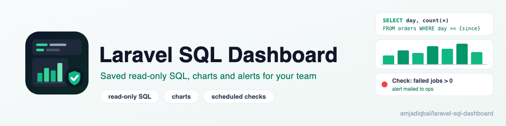
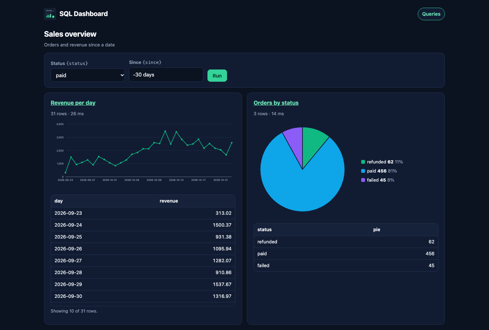

<p align="center">
  <picture>
    <source media="(prefers-color-scheme: dark)" srcset="art/banner-dark.png">
    
  </picture>
</p>

# Laravel SQL Dashboard: read-only SQL queries, charts and alerts for Laravel

A self-hosted SQL dashboard for your Laravel app, in the spirit of Rails' Blazer. Your team saves SQL queries
with typed variables, sees the results as a table and a line, bar or pie chart, downloads them as CSV, puts
several on a dashboard, and gets an email when a scheduled check returns rows or crosses a threshold
(Slack too, untested; see below). Every run is in an audit log with who ran it.

It is built to be safe to leave switched on: queries run **only on a separate read-only connection**, one
`SELECT` or `WITH` statement at a time, inside the database's own read-only transaction, with a row limit and
a statement timeout on MySQL, MariaDB, PostgreSQL and SQLite. A connection that can write is refused. Variables
are always bound as parameters. Until you define the gates, the dashboard opens only when
`app()->environment('local')` is true; every other environment gets a 403.

Docs and demo: https://amjad.com.pk/laravel/packages/laravel-sql-dashboard

[](https://packagist.org/packages/amjadiqbal/laravel-sql-dashboard)
[](https://packagist.org/packages/amjadiqbal/laravel-sql-dashboard)
[](LICENSE.md)

<p align="center">
  
</p>

## Features

- **Saved queries** with a name, description and owner, shared with the team or kept private.
- **Typed variables**: write `{since}` or `{status}` in the SQL and pick a type (text, whole number, number,
  date, date and time, yes/no, one of a list). Values are checked against the type and bound as parameters.
  Dates accept `today`, `yesterday` or `-7 days`, so a saved query or check always looks at a fresh window.
- **Results** as a table with a **CSV export** (formula cells neutralised so a spreadsheet can't run them).
- **Charts picked from the result's shape**: a date then numbers draws a line, a label then numbers draws bars,
  a column named `pie` draws a pie. Or choose line, bar, pie or table per query. Drawn as SVG on the server:
  no JavaScript library, no CDN.
- **Dashboards** of several queries, with one form for the variables they share.
- **Scheduled checks** every 5 minutes, hour or day: fail when the query returns any row, or when a value in
  the first row crosses a threshold. Mail alerts when a check starts failing, passes again or errors, and
  Slack alerts (untested, see below).
- **Audit log** of every run, export, check and refused attempt: who, when, the SQL, the variables, rows,
  time and outcome.
- **Gates** for viewing, running and editing, closed by default outside `local`.

## Installation

```bash
composer require amjadiqbal/laravel-sql-dashboard
php artisan migrate
```

Requires PHP 8.3+ and Laravel 12 or 13. The tables it creates (`sql_dashboard_*`) hold saved queries,
dashboards, checks and the audit log, on your default connection (or `SQL_DASHBOARD_STORAGE_CONNECTION`).

### 1. Add a read-only connection

The dashboard never runs on your app's own connection. Create a database user that can only read, add a
connection for it in `config/database.php`, and point the dashboard at it:

```php
// config/database.php, in 'connections'
'dashboard' => [
    'driver' => 'mysql', // or mariadb, pgsql
    'host' => env('DB_HOST', '127.0.0.1'),
    'port' => env('DB_PORT', '3306'),
    'database' => env('DB_DATABASE'),
    'username' => env('DASHBOARD_DB_USERNAME'),
    'password' => env('DASHBOARD_DB_PASSWORD'),
    'charset' => 'utf8mb4',
    'collation' => 'utf8mb4_unicode_ci',
],
```

```dotenv
SQL_DASHBOARD_CONNECTION=dashboard
```

**MySQL / MariaDB**

```sql
CREATE USER 'dashboard'@'%' IDENTIFIED BY 'a-long-password';
GRANT SELECT, SHOW VIEW ON your_app.* TO 'dashboard'@'%';
```

**PostgreSQL**

```sql
CREATE ROLE dashboard LOGIN PASSWORD 'a-long-password';
GRANT USAGE ON SCHEMA public TO dashboard;
GRANT SELECT ON ALL TABLES IN SCHEMA public TO dashboard;
ALTER DEFAULT PRIVILEGES FOR ROLE your_migration_role IN SCHEMA public GRANT SELECT ON TABLES TO dashboard;
```

**SQLite**: open the same file read-only.

```php
'dashboard' => [
    'driver' => 'sqlite',
    'database' => database_path('database.sqlite'),
    // PHP 8.3: [PDO::SQLITE_ATTR_OPEN_FLAGS => PDO::SQLITE_OPEN_READONLY]
    'options' => [Pdo\Sqlite::ATTR_OPEN_FLAGS => Pdo\Sqlite::OPEN_READONLY],
],
```

Then check it:

```bash
php artisan sql-dashboard:verify
```

```text
Connection: dashboard
Driver:     MySQL / MariaDB
Limits:     15s timeout, 1000 rows
Ready: the connection is read-only and SELECT 1 returned 1 in 9 ms.
```

### 2. Decide who can use it

Open `/sql-dashboard`. While `app()->environment('local')` is true you are let in; in every other environment
every page is a 403 until you define the three gates, for example in `AppServiceProvider::boot()`:

```php
use Illuminate\Support\Facades\Gate;

Gate::define('viewSqlDashboard', fn ($user = null) => $user?->is_admin || $user?->is_analyst);
Gate::define('runSqlDashboardQueries', fn ($user = null) => $user?->is_admin || $user?->is_analyst);
Gate::define('editSqlDashboardQueries', fn ($user = null) => (bool) $user?->is_admin);
```

| Gate | Lets someone |
|---|---|
| `viewSqlDashboard` | open the dashboard and see saved queries and dashboards |
| `runSqlDashboardQueries` | run saved queries and dashboards, download CSV |
| `editSqlDashboardQueries` | write SQL, manage dashboards and checks, read the audit log |

Writing SQL also needs a signed-in user, whatever your gate returns: raw SQL never comes from a guest.

### 3. Run the scheduler for checks

Checks need Laravel's scheduler, which most apps already run:

```bash
* * * * * cd /path-to-your-app && php artisan schedule:run >> /dev/null 2>&1
```

The package schedules `sql-dashboard:run-checks` every minute (each check runs at its own interval) and
`sql-dashboard:prune-audit` daily. For Slack, create an incoming webhook and set
`SQL_DASHBOARD_SLACK_WEBHOOK_URL`. The webhook only comes from your environment, never from the browser.
Slack delivery is implemented and tested only against a faked HTTP client, not a real Slack workspace yet;
please [open an issue](https://github.com/amjadiqbal/laravel-sql-dashboard/issues) if it doesn't arrive.

## Using it

**Queries.** Press *New query*, write SQL, press *Run* (or Ctrl/⌘ + Enter) to see the result, then *Save*.
Untick *Share with the team* to keep a query private.

```sql
SELECT day, count(*) AS orders, sum(total) AS revenue
FROM orders
WHERE status = {status} AND day >= {since}
GROUP BY day
ORDER BY day
```

Each `{variable}` gets a type, a label, a default and (for lists) its options. Here `{status}` could be a list
of `paid, refunded, failed` and `{since}` a date defaulting to `-30 days`. A `{variable}` inside quotes is
plain text; the editor tells you. Variables stand for values only, never for table or column names.

**Charts.** The first column decides: a date gives a line per number column (or per label, for
`date, label, number`); a label gives bars. Name the number column `pie`
(`SELECT country, count(*) AS pie FROM customers GROUP BY country`) for a pie chart. Up to 500 points and 8
series are drawn.

**Dashboards.** Pick queries to show together. Variables with the same name share one input at the top.

**Checks.** On a query, press *Add check*. A check runs the query with each variable's default value (so every
variable needs one) and fails when:

- *any row is returned*: write the query to find bad data, e.g.
  `SELECT id, email FROM users WHERE email_verified_at IS NULL AND created_at < {week_ago}`
- *a value crosses a threshold* in the first row, e.g. `SELECT count(*) AS failed FROM failed_jobs` above `0`.

You get one alert when it starts failing, one when it passes again, and one if it errors, not one every run.

**Audit log.** *Audit log* lists every run with who, when, from where (page, editor, dashboard, export,
check, console), the SQL, the variable values, rows, milliseconds and the outcome, including refused attempts.

## Security

The dashboard runs SQL typed into a browser. It protects your data with three checks: a dialect-aware
tokenizer (not a full SQL parser), the database's own read-only transaction, and a check that the database
user cannot write. A write to your tables is stopped by the read-only transaction and by the user's
privileges, each on its own. Side effects that a read-only transaction does not cover (reading server files,
locks that outlive the transaction, opening another connection) are stopped by the tokenizer's deny-list,
backed by the user check refusing roles that have those powers. It is not a sandbox: see the limits below.

1. **The statement allow-list: a dialect-aware tokenizer (not a full SQL parser).** It splits SQL into
   tokens with each database's quoting and comment rules (strings, quoted names, nested PostgreSQL
   comments, dollar quotes, MySQL's `--` and `#` rules) and checks that it is
   **one** `SELECT` or `WITH` statement. It refuses `INSERT`, `UPDATE`, `DELETE`, `MERGE`, DDL, `INTO`
   (including `INTO OUTFILE`), locking reads (`FOR UPDATE`, `FOR SHARE`), a second statement after a
   semicolon, writes hidden in a CTE (`WITH x AS (DELETE ... RETURNING *) SELECT ...`), raw `?`, `$1` or
   `:name` parameters, MySQL executable comments (`/*! ... */`), PostgreSQL `U&"..."` escaped names, and a
   deny-list of functions with side effects (`set_config`, advisory locks, `nextval`, `pg_read_file` and the
   other server-file functions, large objects, `dblink`, `GET_LOCK`, `LOAD_FILE`, `load_extension` and more),
   however the name is written: bare, `"quoted"`, `` `quoted` ``, `[quoted]` or schema-qualified. Where text
   could be read two ways, it refuses rather than guesses. It is a deny-list, not an allow-list of safe
   functions, because an allow-list would refuse your own functions and extensions; the next two checks are
   what make a missed name harmless.
2. **The database's own read-only mode.** MySQL and MariaDB run each query in `START TRANSACTION READ ONLY`,
   PostgreSQL in `BEGIN READ ONLY` behind `DECLARE ... CURSOR` (which only accepts a query), and SQLite opens
   the file read-only with `query_only` on, in a separate process (on PHP 8.5, SQLite's authorizer also
   allows only reads). The database itself refuses a write, even one the tokenizer missed; the test suite
   proves this by sending writes straight to this layer with an admin login. After each query the dashboard
   releases any advisory (PostgreSQL) or `GET_LOCK` (MySQL) lock the session took.
3. **A user that cannot write or reach outside the database.** Before running, the dashboard checks the
   connection's user. On MySQL and MariaDB every privilege in `SHOW GRANTS` must be a read privilege
   (`SELECT`, `SHOW VIEW`, ...; `FILE`, `PROCESS`, `SUPER` and roles are refused). On PostgreSQL the role must
   not be a superuser, must not be a member of `pg_read_server_files`, `pg_write_server_files`,
   `pg_execute_server_program` or `pg_signal_backend`, must not be able to execute `dblink` or the
   server-file functions, must not be able to execute another role's `SECURITY DEFINER` function (it runs
   with its owner's powers, which a read-only transaction does not limit outside the session), must not
   have `USAGE` on a foreign server, and must not own, or hold `INSERT`,
   `UPDATE`, `DELETE` or `TRUNCATE` on, any table, view, materialized view or foreign table (or `UPDATE`
   on any sequence). On SQLite the connection must open the file read-only.
   Otherwise nothing runs. A read replica (`super_read_only`, or a PostgreSQL standby) skips the write
   checks but not the others. The dashboard also refuses the connection it stores its own data on.

And around them:

| Limit | MySQL | MariaDB | PostgreSQL | SQLite |
|---|---|---|---|---|
| Statement timeout | `max_execution_time` | `max_statement_time` | `statement_timeout`, `lock_timeout` | runs in a child process that is killed |
| Row limit | `sql_select_limit` + unbuffered fetch | same | server-side cursor, fetched in batches | stops reading |
| Size limit | stops reading at 16 MB | same | same | same |

Variables are bound as parameters by PDO, never put into the SQL. CSV exports neutralise formula cells.
Alert e-mails contain up to `alerts.rows_in_alert` (10) result rows: limit who can receive them with
`alerts.mail_domains`.
Private queries and dashboards are invisible (404) to everyone but their owner. Session settings the
dashboard changes are put back after each run.

What it does **not** do:

- **Hide columns.** Anyone who can write SQL can read every table the read-only user can, so grant that user
  only the tables (or views) your team should see.
- **Know your server's own add-ons.** MySQL loadable functions (`CREATE FUNCTION ... SONAME`) can be called by
  any user and cannot be seen from a read-only one; the tokenizer refuses the well-known `sys_exec` family,
  but don't install such functions on a server the dashboard reads.
- **Protect shared work from editors.** Anyone who passes the `editSqlDashboardQueries` gate can edit or
  delete every shared query, dashboard and check, as in Blazer. Keep that gate for people you trust with the
  SQL; private queries stay private to their owner.

## Configuration

```bash
php artisan vendor:publish --tag=sql-dashboard-config
```

| Key | Default | |
|---|---|---|
| `connection` | `SQL_DASHBOARD_CONNECTION` | the read-only connection queries run on |
| `storage_connection` | default connection | where queries, dashboards, checks and the audit log live |
| `limits.timeout` | `15` | seconds before a statement is stopped |
| `limits.max_rows`, `limits.export_max_rows` | `1000`, `10000` | rows shown in the browser, rows in a CSV export |
| `path`, `domain`, `middleware` | `sql-dashboard`, none, `['web']` | where the pages live; the gates always run after your middleware |
| `schedule` | `true` | register `run-checks` (every minute) and `prune-audit` (daily) |
| `alerts.slack_webhook_url` | `SQL_DASHBOARD_SLACK_WEBHOOK_URL` | Slack incoming webhook (untested against real Slack) |
| `alerts.mail_domains` | `[]` (any) | e.g. `['acme.com']` to keep alert mail inside the company |
| `alerts.rows_in_alert` | `10` | result rows included in an alert e-mail |
| `intervals` | 5 minutes, hourly, daily | the check schedules people can pick |
| `audit.retention_days` | `90` | `null` keeps the audit log forever |

Commands: `sql-dashboard:verify`, `sql-dashboard:run-checks [--check=ID] [--force]` and
`sql-dashboard:prune-audit [--days=N]`. `php artisan about` shows the version, path and connection.

## Testing

```bash
composer test                # unit and feature tests, including real SQLite runs
scripts/integration.sh       # real MySQL 8.4, MariaDB 11 and PostgreSQL 16 in Docker: the security suite
scripts/ci-local.sh          # PHP 8.3-8.5 x Laravel 12-13, Pint, PHPStan, then the integration run
```

## Need this built into your app, or something custom?

I build reporting, dashboards and data tooling for Laravel apps, from the SQL behind a KPI to alerting on bad
data, and I build Laravel packages. If you want this set up for your team, or need something it doesn't do,
[get in touch](https://amjad.com.pk/contact?utm_source=github&utm_medium=readme&utm_campaign=laravel-sql-dashboard).

## Support

- 🐛 **Bug or feature request**: [open an issue](https://github.com/amjadiqbal/laravel-sql-dashboard/issues)
- 🔒 **Security issue**: please report privately via GitHub's security tab

## Need this customised, or something built?

I'm available for custom development, package integration, and technical consulting.

[](https://www.upwork.com/freelancers/amjadkhatri)

## More packages

Part of a family of open-source packages. See [all of them](https://github.com/amjadiqbal?tab=repositories).

| | |
|---|---|
| [laravel-mysql-advisor](https://github.com/amjadiqbal/laravel-mysql-advisor) | Read-only MySQL and MariaDB health checks with the fix SQL |
| [laravel-redis-advisor](https://github.com/amjadiqbal/laravel-redis-advisor) | Redis health checks for Laravel |
| [kiln](https://github.com/amjadiqbal/kiln) | Deploy-time OPcache control for Laravel |
| [laravel-driver-js](https://github.com/amjadiqbal/laravel-driver-js) | Product tours and onboarding for Laravel |

## Changelog

See [CHANGELOG.md](CHANGELOG.md).

## License

MIT. See [LICENSE.md](LICENSE.md). Inspired by [Blazer](https://github.com/ankane/blazer) for Rails; this is an
independent Laravel package with its own code.
